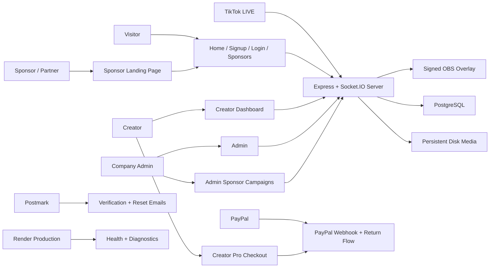
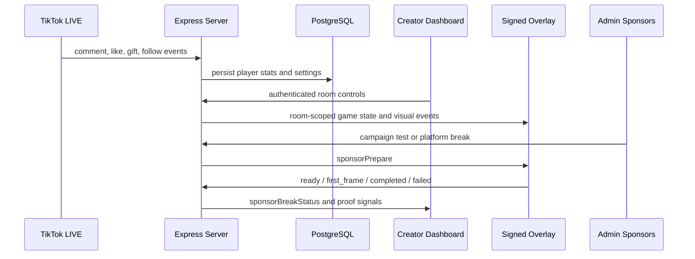
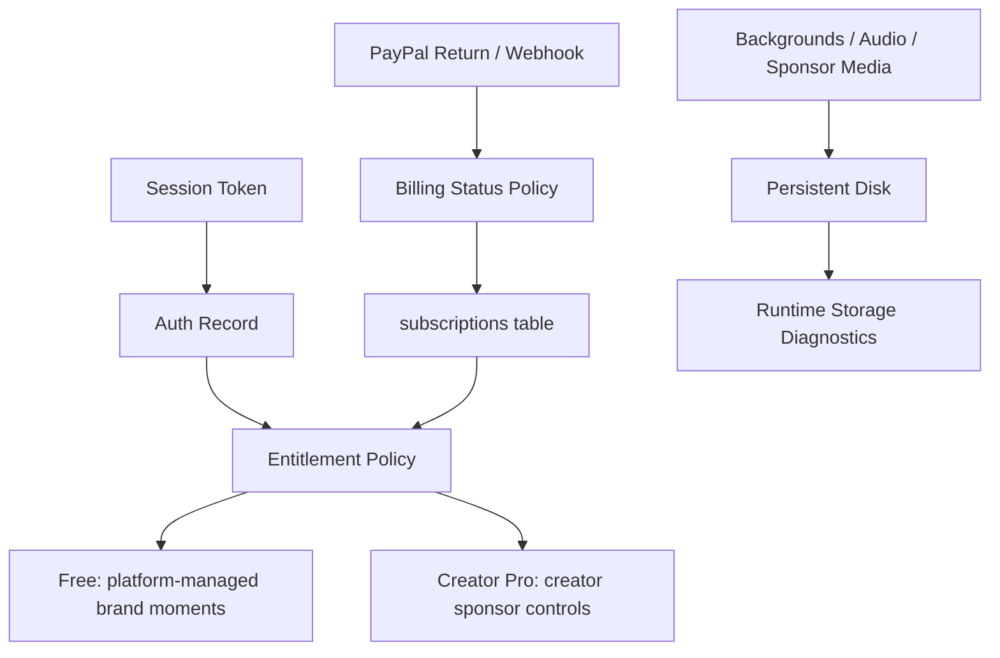

# IntoTheBattle Master App Visualization

This document is the current professionalization map for IntoTheBattle. It separates what is already working from what still needs product, reliability, or operational polish before the app can be treated as a complete production platform.

## Product Surface

## Runtime Flow

## Current Professional Baseline

- Public pages: home, signup, register, login, sponsors, paywall, verification, reset, billing result.
- Authenticated creator pages: dashboard, welcome, profile, stats.
- Admin pages: access code management and platform sponsor creative management.
- Overlay: signed room-scoped OBS URL, Socket.IO event stream, battle renderer, sponsor break choreography, media readiness reporting.
- Billing: PayPal config, subscription activation, webhook, success/cancel/error return pages.
- Email: Postmark verification, resend, password reset, runtime email diagnostic endpoint.
- Storage: persistent disk paths for background, audio, creator sponsor media, and platform sponsor media.
- Observability: `/healthz`, protected metrics, protected diagnostics, launch readiness checks, CI smoke and visual tests.

## Business Logic Backbone

- Entitlements now live in one shared service so dashboard, overlay, and sponsor controls agree on free vs paid.
- A plain active trial/access code no longer counts as paid unless it has a PayPal subscription or an explicit paid code type/status.
- PayPal status normalization now preserves `pending`, `active`, `suspended`, `cancelled`, and `expired`.
- Runtime diagnostics can report persistent disk usage by top-level media folder.
- Launch readiness checks now summarize production blockers across runtime config, database, email, payments, OAuth, storage, overlay signing, and media tooling.
- Logic smoke tests now cover free/paid rules and PayPal lifecycle normalization.

## Recent Stabilization Passes

- Removed broad `express.static(__dirname)` root serving so source files and package metadata are no longer public assets.
- Added explicit public asset routes for logos, robots, sitemap, and `/js/*`.
- Added HTTP smoke coverage proving `/server.js`, `/package.json`, `/package-lock.json`, and legacy overlay files are not publicly served.
- Fixed the stability audit syntax error and made root static serving a hard audit failure.
- Made the email/password login a real form, improving accessibility and Enter-key behavior.
- Changed unauthenticated PayPal config loading to return a safe login prompt without a browser console 401.
- Updated Playwright visual tests to use stable visible controls and `domcontentloaded` for live Socket.IO pages.
- Pinned `@tiktool/live` to the lockfile version `2.7.1`.
- Rebaselined generated schema validation reports to the current page set.

## Highest-Impact Remaining Work

1. Remove legacy dashboard password/cookie auth after confirming no active production workflow depends on it.
2. Move remaining large server modules out of `server.js` into route, service, socket, and game modules.
3. Add CSRF protection to admin form posts and any future destructive browser form action.
4. Replace query-string diagnostic/metrics tokens with Authorization-only access in production once operational tooling is ready.
5. Finish sponsor platform reporting with exportable campaign summaries: impressions, first frames, completions, failures, and completion rate.
6. Add media lifecycle states to disk cleanup: uploaded, normalized, active, archived, deleted.
7. Add a full authenticated signup, checkout, email verification, and dashboard journey test with mocked Postmark and mocked PayPal.
8. Add automated archived/deleted media cleanup rules once sponsor campaigns begin rotating real inventory.
9. Create a canonical design system file for shared colors, buttons, forms, cards, and page layout.
10. Plan a Phaser or modular renderer migration only after the current overlay is stable under real traffic.

## Professional Definition Of Done

The app should not be called complete until these gates pass on every release:

- `npm ci`
- `node --check server.js`
- `npm run audit:stability`
- `npm run validate:schemas`
- `npm run test:logic`
- `npm run test:http`
- `npm run test:socket`
- `npm run test:e2e`
- `npm run launch:check` in the target environment
- Render deploy reaches live
- Production `/healthz` returns `200 ok`
- Production launch readiness reports no hard failures
- Manual live smoke confirms Google login, email verification, PayPal subscription activation, dashboard upload flows, overlay connection, and sponsor video playback
